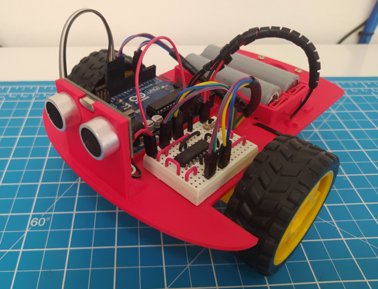

# Robô NAV: seu primeiro robô autônomo! (Versão L293D)
Se você quer dar os primeiros passos na robótica sem complicação, o NAV é o projeto ideal para começar. Ele é a montagem mais clássica e simples do universo Arduino: um carrinho sobre um chassi 2WD equipado com um sensor ultrassônico HC-SR04 que funciona como um "sonar" para ele enxergar o caminho e desviar de paredes, móveis ou do seu cachorro antes de sair batendo por aí.

Além de usar peças super acessíveis, você pode montar e testar todo o circuito gratuitamente no Tinkercad antes mesmo de encostar em uma chave de fenda. É a porta de entrada perfeita para você sair do básico e ver seu código ganhando rodas!

## Autor
Professor José de Assis
## Simulador do projeto
[thinkercad](https://www.tinkercad.com/things/700iF4M9QNX-robo-nav-l293n)

---
> [!TIP]
> 🤖 **Quer montar este robô?** Confira o [**Tutorial Passo a Passo completo na Wiki**](https://github.com/roboticapratica/robo-nav/wiki) com a lista de materiais, montagem do chassi, ligações e sensores!
